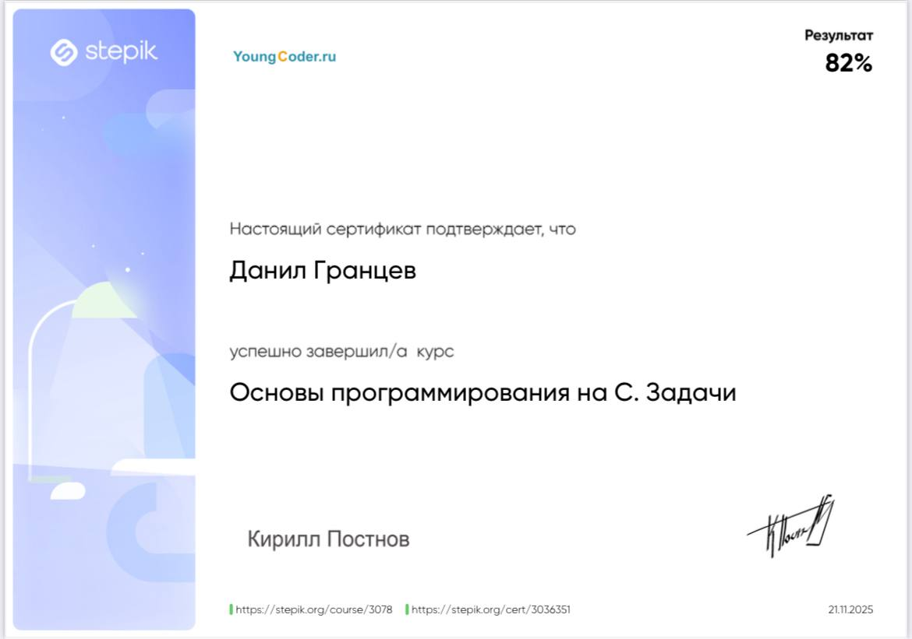

# Сертификаты

## Google Cybersecurity Professional Certificate — Coursera

**Статус:** в процессе — пройдено 4 из 8 курсов, дальше курс 5.

| # | Курс | Статус | Ключевые навыки |
|---|--------|--------|------------|
| 1 | Foundations of Cybersecurity | ✅ [Сертификат](google-cybersecurity/1-foundations-of-cybersecurity.pdf) | Домены безопасности CISSP, NIST CSF, этика, основы реагирования на инциденты |
| 2 | Play It Safe: Manage Security Risks | ✅ [Сертификат](google-cybersecurity/2-play-it-safe-manage-security-risks.pdf) | Управление рисками, фреймворки и меры контроля, SIEM-инструменты, плейбуки |
| 3 | Connect and Protect: Networks and Network Security | ✅ [Сертификат](google-cybersecurity/3-connect-and-protect-networks.pdf) | TCP/IP, сетевые атаки (DoS, SYN- / ICMP-флуд), харденинг (усиление защиты) ОС и сети |
| 4 | Tools of the Trade: Linux and SQL | ✅ [Сертификат](google-cybersecurity/4-tools-of-the-trade-linux-and-sql.pdf) · [Проверить](https://coursera.org/verify/HA7QIWMN15VT) | Bash, права доступа к файлам, SQL-запросы к данным безопасности |
| 5 | Assets, Threats, and Vulnerabilities | ⏳ Следующий | Инвентаризация активов, моделирование угроз, управление уязвимостями |
| 6–8 | Обнаружение и реагирование · Автоматизация на Python · Подготовка к трудоустройству | ⏳ Запланировано | |

Практические работы по этим курсам: [отчёты об инцидентах](../cybersecurity/incident-response/) и
[аудит безопасности Botium Toys](../cybersecurity/audit/).

## Основы программирования на C — Stepik

**Завершён:** 21 ноября 2025 г. · **Результат:** 82% · [Проверить](https://stepik.org/cert/3036351)

Темы: C, алгоритмы, структуры данных, решение задач.

## Самостоятельная практика

Программа в домашней лаборатории, охватывающая QEMU, Nmap, Wireshark, DVWA, Wazuh SIEM и Suricata. Сертификата нет —
результаты задокументированы в виде [практических лабораторных работ](../cybersecurity/).
