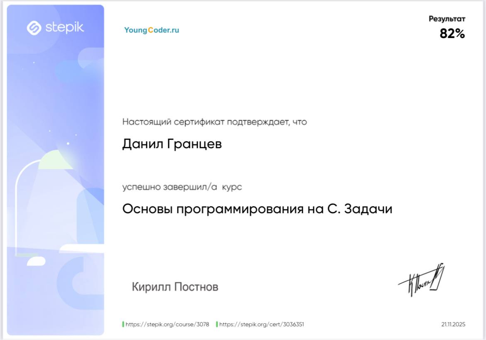

# Certifications

## Google Cybersecurity Professional Certificate — Coursera

**Status:** in progress — 3 of 8 courses completed, course 4 underway.

| # | Course | Status | Key skills |
|---|--------|--------|------------|
| 1 | Foundations of Cybersecurity | ✅ [Certificate](google-cybersecurity/1-foundations-of-cybersecurity.pdf) | CISSP security domains, NIST CSF, ethics, incident response basics |
| 2 | Play It Safe: Manage Security Risks | ✅ [Certificate](google-cybersecurity/2-play-it-safe-manage-security-risks.pdf) | Risk management, frameworks and controls, SIEM tools, playbooks |
| 3 | Connect and Protect: Networks and Network Security | ✅ [Certificate](google-cybersecurity/3-connect-and-protect-networks.pdf) | TCP/IP, network attacks (DoS, SYN / ICMP flood), OS and network hardening |
| 4 | Tools of the Trade: Linux and SQL | 🟡 In progress | Bash, file permissions, SQL queries for security data |
| 5–8 | Assets & threats · Detection & response · Python automation · Job readiness | ⏳ Planned | |

Practical work from these courses: [incident reports](../cybersecurity/incident-response/) and the
[Botium Toys security audit](../cybersecurity/audit/).

## C Programming Fundamentals — Stepik

**Completed:** November 21, 2025 · **Result:** 82% · [Verify](https://stepik.org/cert/3036351)

Topics: C, algorithms, data structures, problem solving.

## Self-directed practice

A home-lab program covering QEMU, Nmap, Wireshark, DVWA, Wazuh SIEM and Suricata. No certificate — the results are
documented as [hands-on labs](../cybersecurity/).
