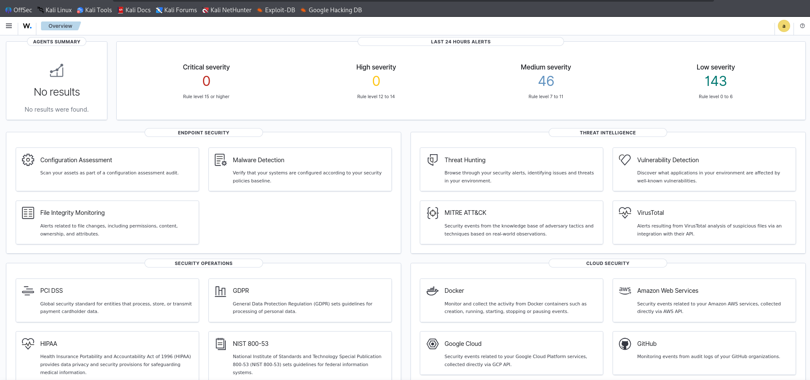
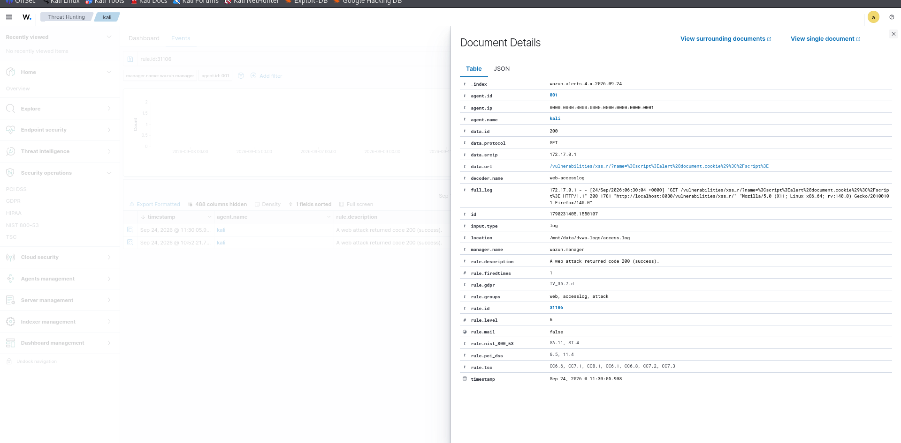

# SIEM with Wazuh — Detecting Web Attacks on DVWA

## Objective

Deploy Wazuh SIEM, ship web server logs from a vulnerable test application (DVWA) through a Wazuh agent, detect
web attacks (XSS, SQL injection) in near real time — and verify that the detections actually fire.

## Lab setup

- Wazuh 4.10.0 single-node in Docker (manager, indexer, dashboard)
- Wazuh agent 4.9.0 on Kali Linux
- DVWA in Docker on port 8080, Apache access logs mounted to the host

```text
┌──────────────┐   access.log   ┌──────────────┐   1514/tcp   ┌──────────────┐
│ DVWA         │ ─────────────▶ │ Wazuh agent  │ ───────────▶ │ Wazuh        │
│ (Docker)     │   (volume)     │ (Kali)       │              │ manager      │
└──────────────┘                └──────────────┘              └──────┬───────┘
                                                                     │
                                                              ┌──────▼───────┐
                                                              │ Indexer +    │
                                                              │ Dashboard    │
                                                              └──────────────┘
```

## Setup

### 1. Wazuh stack

```bash
git clone https://github.com/wazuh/wazuh-docker.git -b v4.10.0
cd wazuh-docker/single-node
docker compose -f generate-indexer-certs.yml run --rm generator
docker compose up -d
```

Default passwords were changed before first use: `INDEXER_PASSWORD` and `API_PASSWORD` in `docker-compose.yml`,
user hashes in `config/wazuh_indexer/internal_users.yml`, and the API password in
`config/wazuh_dashboard/wazuh.yml`.

### 2. DVWA with logs on a host volume

```bash
docker run -d -p 8080:80 --name dvwa \
  -v /mnt/data/dvwa-logs:/var/log/apache2 \
  vulnerables/web-dvwa
```

### 3. Agent on Kali

```bash
curl -s https://packages.wazuh.com/key/GPG-KEY-WAZUH | sudo gpg --dearmor -o /usr/share/keyrings/wazuh.gpg
echo "deb [signed-by=/usr/share/keyrings/wazuh.gpg] https://packages.wazuh.com/4.x/apt/ stable main" \
  | sudo tee /etc/apt/sources.list.d/wazuh.list
sudo apt update && sudo apt install wazuh-agent -y
```

`/var/ossec/etc/ossec.conf`:

```xml
<client>
  <server>
    <address>localhost</address>
    <port>1514</port>
    <protocol>tcp</protocol>
  </server>
</client>

<localfile>
  <log_format>apache</log_format>
  <location>/mnt/data/dvwa-logs/access.log</location>
</localfile>
```

## Test traffic

Payloads sent to DVWA (security level: low):

```text
SQL injection:   1' OR '1'='1
Reflected XSS:   <script>alert('XSS')</script>
                 <script>alert(document.cookie)</script>
```

## Results

Wazuh decoded the Apache logs (`web-accesslog`) and raised rule **31106** — *"A web attack returned code 200
(success)"*, level 6, groups `web, accesslog, attack`. Code 200 matters: the request was not blocked, so the
analyst should treat it as a likely successful attack, not just a probe.

| Evidence | Payload | Rule | Files |
|----------|---------|------|-------|
| Reflected XSS | `<script>alert('XSS')</script>` | 31106, level 6 | [`xss-alert-basic.json`](xss-alert-basic.json), [`xss-alert-basic.png`](xss-alert-basic.png) |
| Reflected XSS, cookie access | `<script>alert(document.cookie)</script>` | 31106, level 6 | [`xss-alert-cookie.json`](xss-alert-cookie.json), [`xss-alert-cookie.png`](xss-alert-cookie.png) |
| Boolean SQL injection | `1' OR '1'='1` | **none** with default rules → 100101, level 8 with a [local rule](#detection-gap-boolean-based-sql-injection) | [`detection-gap/`](detection-gap/) |

The dashboard showed 189 alerts in the last 24 hours (46 medium, 143 low).





### Compliance tags from Wazuh rule metadata

Wazuh attaches these tags to rule 31106 automatically: PCI DSS 6.5 and 11.4, NIST 800-53 SA.11 and SI.4,
GDPR IV_35.7.d, TSC CC6.1 / CC6.6 / CC6.8 / CC7.1 – CC7.3 / CC8.1.

## Detection gap: boolean-based SQL injection

The SQL injection requests produced **no alerts at all**. Wazuh's alert archive for the session (595 alerts) holds
the two XSS alerts and nothing for SQL injection, although DVWA logged every request and the agent was shipping the
same file — the SQLi at 05:52:14 was followed by an XSS at 05:52:21 that did alert.

| Time (UTC, Sep 24) | Request | Alert with default rules |
|--------------------|---------|--------------------------|
| 05:43:51 | `/vulnerabilities/sqli/?id=1' OR '1'='1` | none |
| 05:51:43 | same | none |
| 05:52:14 | same | none |
| 05:52:21 | `/vulnerabilities/xss_r/?name=<script>alert('XSS')</script>` | 31106 |
| 06:29:57 | `/vulnerabilities/sqli/?id=1' OR '1'='1` | none |
| 06:30:04 | `/vulnerabilities/xss_r/?name=<script>alert(document.cookie)</script>` | 31106 |

**Root cause.** Rule 31103 ("SQL injection attempt") looks for keywords in the URL: `select`, `union`, `insert`,
`from`, `where`, `null,null`, `xp_cmdshell`. A tautology such as `1' OR '1'='1` contains none of them, so the event
stops at rule 31100 (level 0) and no alert is raised.

**Fix.** Two local rules in [`local_rules.xml`](detection-gap/local_rules.xml):

- **100100**, level 7 — a quote, then `OR` / `AND`, then a comparison, raw or URL-encoded;
- **100101**, level 8 — the same with response code 200, meaning the request reached the application.

Deploy: copy the file to `/var/ossec/etc/rules/local_rules.xml` on the manager and restart it.

**Validation** with `wazuh-logtest` on Wazuh 4.10.0 (the lab version), using the real log lines from
[`dvwa-access-sqli.log`](detection-gap/dvwa-access-sqli.log):

| Log lines | Default rules | With local rules |
|-----------|---------------|------------------|
| SQL injection (4) | 31100, level 0 — no alert | 100101, level 8 — alert |
| XSS (2) | 31106, level 6 — alert | 31106, level 6 — unchanged |

Full output: [default rules](detection-gap/logtest-default-rules.txt) ·
[with local rules](detection-gap/logtest-with-local-rules.txt).

**False positives.** The whole DVWA access log (100 lines over two days) plus five benign URLs with apostrophes
([`benign-urls.log`](detection-gap/benign-urls.log): `o'reilly`, `don't`, `rock'n'roll`, `O'Brien and Smith`,
`status=active and type=order`) — the new rules fired on exactly the 6 SQL injection requests and nothing else.

**Limits.** The rule covers quoted tautologies. It does not cover numeric ones (`1 OR 1=1`), comment-based payloads
(`admin'--`), POST bodies (they are not in access logs) or heavy obfuscation — those need a WAF or
application-level logging.

## Triage notes

1. **Is it real?** Payload is a known XSS pattern and the response code is 200 — the page reflected it.
2. **Scope:** single source IP (`172.17.0.1`, the Docker bridge), one endpoint (`/vulnerabilities/xss_r/`).
3. **Response in a real environment:** block or rate-limit the source, fix output encoding on the endpoint, add a
   Content Security Policy, set `HttpOnly` on session cookies, and check for session reuse after the alert time.

## Key learnings

- Container logs must be exposed through a volume for the agent to read them
- `log_format` must be `apache` for the web attack rules to match
- A status code in the alert changes priority: 200 means the attack reached the application
- Default rules are keyword-based: replay real attack traffic through `wazuh-logtest` instead of assuming coverage

## Related

- [How these attacks work and how to fix them](../web-vulns/)
- [Network IDS with Suricata](../ids-suricata/)
