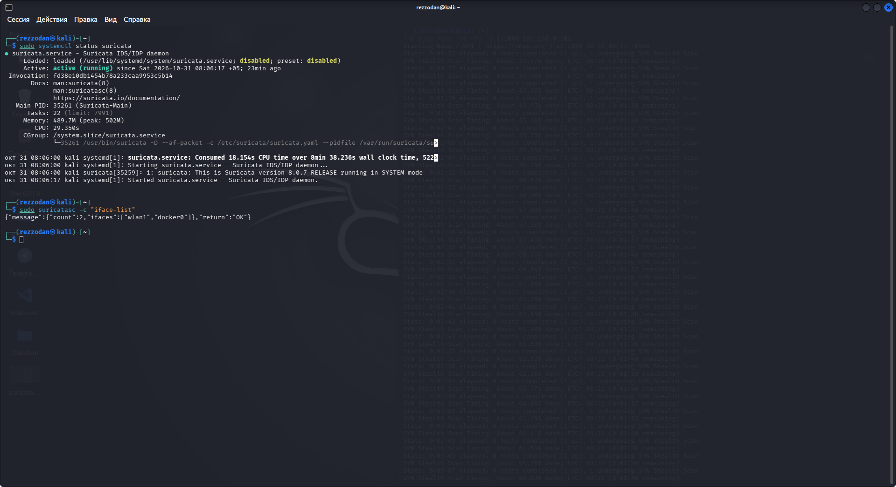
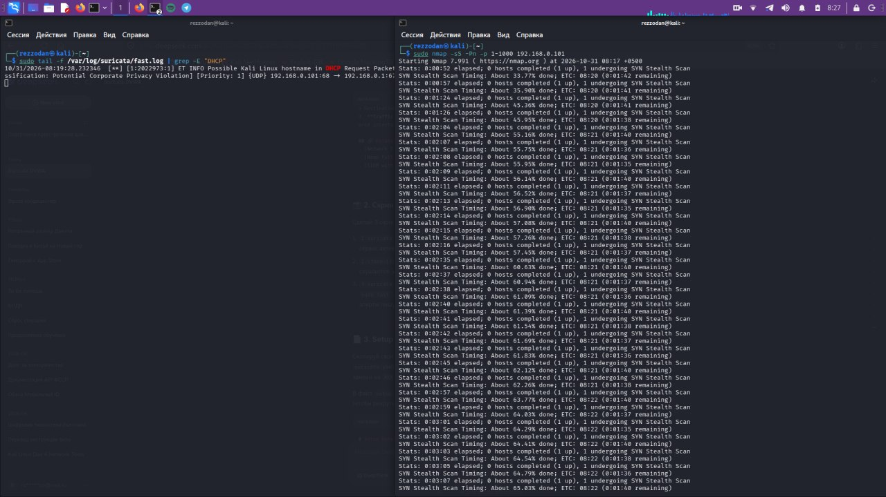

# Сетевая IDS на Suricata

## Цель

Запустить Suricata в качестве сетевой системы обнаружения вторжений на рабочей станции Kali, отслеживать как
беспроводной интерфейс, так и мост Docker, к которому подключены лабораторные контейнеры, и проанализировать
генерируемые ею алерты.

## Настройка

- Suricata 8.0.7 как служба systemd, режим захвата AF_PACKET
- Интерфейсы: `wlan1` (LAN) и `docker0` (лабораторные контейнеры, например DVWA)
- `HOME_NET` задан как частные диапазоны `192.168.0.0/16, 10.0.0.0/8, 172.16.0.0/12`
- Правила загружаются из `suricata.rules` (набор правил Emerging Threats Open)
- Вывод: `fast.log` для быстрого просмотра и `eve.json` для загрузки в SIEM

Соответствующая часть конфигурации ([полный пример](config/suricata.yaml.example)):

```yaml
af-packet:
  - interface: wlan1
    cluster-id: 99
    cluster-type: cluster_flow
    defrag: yes
  - interface: docker0
    cluster-id: 98
    cluster-type: cluster_flow
    defrag: yes
```

Проверка службы и интерфейсов захвата:

```bash
sudo systemctl status suricata
sudo suricatasc -c "iface-list"
# {"message":{"count":2,"ifaces":["wlan1","docker0"]},"return":"OK"}
```



## Тест и анализ алертов

Пока Suricata работала, из второго терминала было запущено TCP SYN-сканирование рабочей станции, а журнал алертов
отслеживался в реальном времени:

```bash
sudo nmap -sS -Pn -p 1-1000 192.168.0.101
sudo tail -f /var/log/suricata/fast.log
```

Пример алерта, зафиксированного во время сеанса:

```text
[**] [1:2022973:1] ET INFO Possible Kali Linux hostname in DHCP Request Packet [**]
[Classification: Potential Corporate Privacy Violation] [Priority: 1] {UDP} 192.168.0.101:68 -> 192.168.0.1:67
```



**Разбор (триаж):** рабочая станция сообщила имя хоста `kali` в своём DHCP-запросе. В корпоративной сети это
полезный сигнал — в LAN появился дистрибутив для наступательной безопасности (offensive security), — и его следует
сверить с инвентаризацией активов. Здесь это собственная лабораторная машина аналитика, поэтому алерт является
**истинным срабатыванием (true positive) с ожидаемой причиной** и его можно донастроить (подавить для этого хоста),
а не эскалировать.

## Ключевые выводы

- Мониторинг `docker0` необходим, чтобы видеть трафик между лабораторными контейнерами; на одном только физическом интерфейсе он не виден
- Информационные правила (`ET INFO`) дают контекст, а не сообщают об атаках — разбор сводится к решению *ожидаемо это или нет*
- Для сканирования портов нужны специальные правила обнаружения сканирования или пороговые значения; по умолчанию алерт на них не гарантирован

## Следующие шаги

- Написать и протестировать локальное правило с порогом для SYN-сканирований, направленных на `HOME_NET`
- Отправлять `eve.json` в менеджер Wazuh, чтобы сопоставлять (коррелировать) сетевые и хостовые алерты в одном месте

## Связанные материалы

- [SIEM на Wazuh](../SIEM/)
- [Полное сканирование Nmap](../nmap-scan/)
