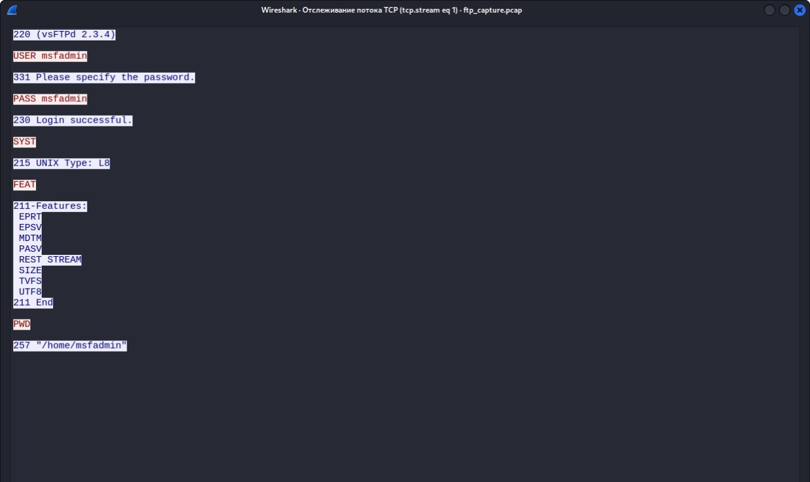
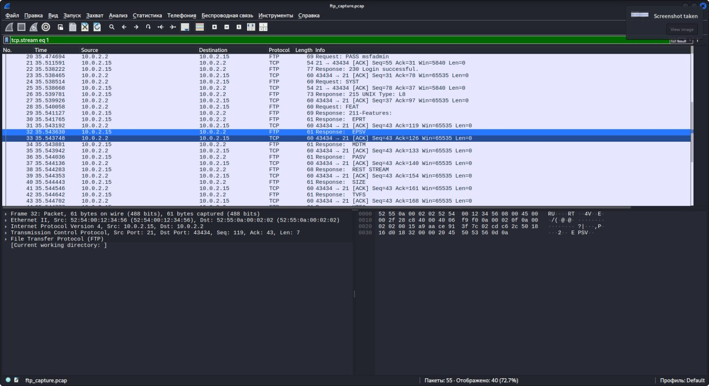

# Захват FTP-трафика — учётные данные открытым текстом

## Цель

Захватить FTP-трафик в изолированной лаборатории и показать, почему устаревшие протоколы, передающие данные открытым
(незашифрованным) текстом, представляют риск: любой, кто находится на сетевом пути, может прочитать учётные данные.

## Лабораторный стенд

- Kali Linux (машина аналитика)
- Metasploitable 2 в QEMU (цель, `vsftpd 2.3.4`)
- tcpdump, Wireshark

## Шаги

1. Запустить целевую ВМ с пробросом FTP и SSH на хост:

   ```bash
   qemu-system-x86_64 -m 512 -accel tcg \
     -netdev user,id=net0,hostfwd=tcp::2223-:22,hostfwd=tcp::2121-:21 \
     -device e1000,netdev=net0 \
     -drive file="Metasploitable.vmdk",format=vmdk
   ```

2. Захватить трафик на целевой машине:

   ```bash
   sudo tcpdump -i eth0 -s 0 -w /tmp/ftp_capture.pcap
   ```

3. Войти по FTP с Kali (стандартная лабораторная учётная запись `msfadmin`):

   ```bash
   ftp localhost 2121
   ```

4. Скопировать файл захвата на Kali и открыть его в Wireshark:

   ```bash
   scp -o HostKeyAlgorithms=+ssh-rsa -o PubkeyAcceptedKeyTypes=+ssh-rsa \
     -P 2223 msfadmin@localhost:/tmp/ftp_capture.pcap ~/
   wireshark ~/ftp_capture.pcap
   ```

5. Применить фильтр `tcp.port == 21`, затем **Follow → TCP Stream**.

## Результат

Управляющий канал FTP передаёт имя пользователя и пароль открытым текстом:

```text
220 (vsFTPd 2.3.4)
USER msfadmin
331 Please specify the password.
PASS msfadmin
230 Login successful.
```





## Обнаружение и меры защиты

| Риск | Мера защиты |
|------|------------|
| Учётные данные можно прочитать при передаче по сети | Заменить FTP на SFTP или FTPS |
| Устаревший сервис доступен извне | Отключить FTP там, где он не нужен, ограничить доступ межсетевым экраном |
| Повторное использование учётных данных | Уникальные пароли, MFA для удалённого доступа |
| Отсутствие видимости | Алерты на протоколы аутентификации с открытым текстом (правила IDS для FTP `USER`/`PASS`) |

## Файлы

- [`ftp_capture.pcap`](ftp_capture.pcap) — сырой файл захвата (только лабораторный трафик)
- [`wireshark-tcp-stream.jpg`](wireshark-tcp-stream.jpg), [`wireshark-packets.jpg`](wireshark-packets.jpg) — скриншоты
