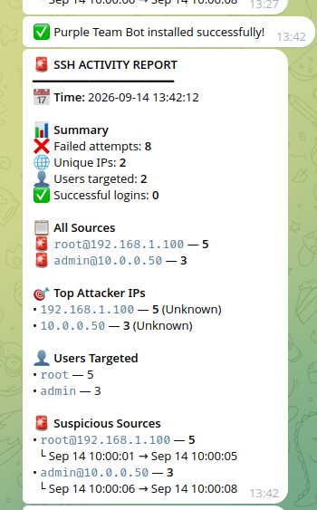

# 🛡️ Purple Team Bot — монитор SSH-брутфорса (перебора паролей)

[](https://github.com/Rezzodan/Portfolio/actions/workflows/purplebot.yml)

Инструмент на Python, который парсит логи аутентификации SSH, помечает источники брутфорса, превысившие порог,
обогащает IP-адреса атакующих данными GeoIP и отправляет алерт в Telegram. Запускается по расписанию через cron.

**Сценарий использования:** небольшая команда без SIEM всё равно сразу видит попытки подбора паролей к своим серверам.



## Архитектура

```text
┌──────────────────┐     ┌────────────────────────┐     ┌──────────────────┐
│ /var/log/auth.log│────▶│ ssh_monitor.py         │────▶│ Telegram Bot API │
│ (sshd events)    │     │ parse → aggregate →    │     │ alert to analyst │
└──────────────────┘     │ threshold → enrich     │     └──────────────────┘
        cron ───────────▶└────────────────────────┘
```

## Возможности

- Обнаруживает события `Failed password`, включая попытки `invalid user`, и считает их для каждой пары `user@ip`
- Отслеживает время первого / последнего появления каждого источника и выделяет источники, превысившие порог
- Показывает успешные входы рядом с неудачными в качестве журнала аудита (audit trail)
- Обогащение данными GeoIP (страна, провайдер) с кэшем в памяти
- Цветной отчёт в терминале и HTML-сводка в Telegram
- Интерактивный установщик: virtualenv, конфигурация, расписание cron, тестовое сообщение

## Безопасность в архитектуре

Бот работает с секретом (токеном Telegram) и недоверенными входными данными (именами пользователей, которые вводят
атакующие), поэтому:

| Риск | Меры защиты |
|------|------------|
| Токен попадает в коммит Git или виден в списке процессов | Конфигурация хранится в `.env` (игнорируется Git, `chmod 600`); установщик запрашивает токен скрытым вводом и никогда не передаёт его в командной строке |
| Утечка токена через сообщения об ошибках (он входит в URL API) | Сетевые ошибки логируются только по типу исключения |
| Имена пользователей, контролируемые атакующим, ломают или подделывают HTML-алерт | Все значения из лога экранируются для HTML перед отправкой — это покрыто тестом |
| Утечка внутренних адресов в сторонний API | Частные / зарезервированные IP никогда не отправляются в сервис GeoIP |
| Алерты незаметно уходят боту-заглушке | Значения-заглушки из `.env.example` отключают Telegram с предупреждением |

## Быстрый старт

```bash
git clone https://github.com/Rezzodan/Portfolio.git
cd Portfolio/cybersecurity/purplebot
sudo ./install.sh
```

Установщик проверяет Python, создаёт `.venv`, запрашивает токен Telegram, chat id, путь к логу и порог, записывает
`.env`, настраивает задание cron, отправляет тестовое сообщение и запускает первое сканирование.

### Ручная установка

```bash
python3 -m venv .venv && source .venv/bin/activate
pip install -r requirements.txt
cp .env.example .env && chmod 600 .env   # fill in TELEGRAM_TOKEN and TELEGRAM_CHAT_ID
python3 send_test_message.py             # check Telegram settings
sudo .venv/bin/python3 ssh_monitor.py
```

Токен получите у **@BotFather**, свой chat id — у **@userinfobot**, а перед этим отправьте `/start` своему боту.

### Конфигурация

| Переменная | По умолчанию | Назначение |
|----------|---------|---------|
| `TELEGRAM_TOKEN` | — | Токен бота от @BotFather |
| `TELEGRAM_CHAT_ID` | — | Куда отправляются алерты |
| `LOG_FILE` | `/var/log/auth.log` | Лог SSH для анализа |
| `THRESHOLD` | `5` | Число неудачных попыток на `user@ip`, при котором источник помечается как подозрительный |
| `ENABLE_GEOIP` | `true` | Определять страну / провайдера для публичных IP |
| `MAX_SOURCES` | `10` | Сколько источников выводится в отчёте |

Переменные окружения переопределяют значения из `.env`.

## Попробуйте на тестовом логе

```bash
LOG_FILE=tests/fixtures/auth.log ENABLE_GEOIP=false python3 ssh_monitor.py
```

```text
─── SUMMARY ───
  ❌ Total failed attempts:  8
  🌐 Unique attacker IPs:    2
  👤 Unique users targeted:  3
  ✅ Successful logins:      1

─── ALL SOURCES ───
  🚨 root@203.0.113.10              █████ 5
  ⚠️  admin@198.51.100.7             ██ 2
  ⚠️  <b>x</b>@198.51.100.7          █ 1
```

Имя пользователя `<b>x</b>` — намеренная попытка инъекции в тестовых данных (fixture): оно выводится как текст
и экранируется в сообщении Telegram.

## Тесты и CI

```bash
pip install pytest ruff
ruff check .   # includes bandit (S) security rules
pytest -q      # 12 tests: parsing, threshold, escaping, config, no GeoIP for private IPs
```

GitHub Actions запускает обе проверки при каждом изменении в этой папке.

## Известные ограничения и следующие шаги

- Порог считает попытки по всему логу, а не в пределах временного окна — следующий шаг: скользящее окно для каждого источника
- При каждом запуске лог перечитывается целиком, поэтому об одной и той же активности сообщается повторно — следующий шаг: запоминать смещение (offset), до которого лог уже прочитан
- В системах без rsyslog события SSH хранятся только в journald — следующий шаг: читать из `journalctl -u ssh`
- Cron запускает монитор от root — ему нужен только доступ на чтение, поэтому лучше выделенный пользователь в группе `adm`
- Реагирование ручное — следующий шаг: опциональная блокировка через fail2ban / файрвол для источников, превысивших порог

## Структура проекта

```text
purplebot/
├── ssh_monitor.py          # parser, report, Telegram alert
├── send_test_message.py    # checks Telegram settings
├── install.sh              # interactive installer + cron
├── requirements.txt
├── pyproject.toml          # pytest and ruff settings
├── .env.example            # config template (real .env is git-ignored)
└── tests/
    ├── fixtures/auth.log   # sample sshd log
    └── test_ssh_monitor.py
```

## Связанные проекты

- [SIEM на Wazuh](../SIEM/)
- [Сетевая IDS на Suricata](../ids-suricata/)

Всё тестирование проводилось в изолированной лабораторной среде.
