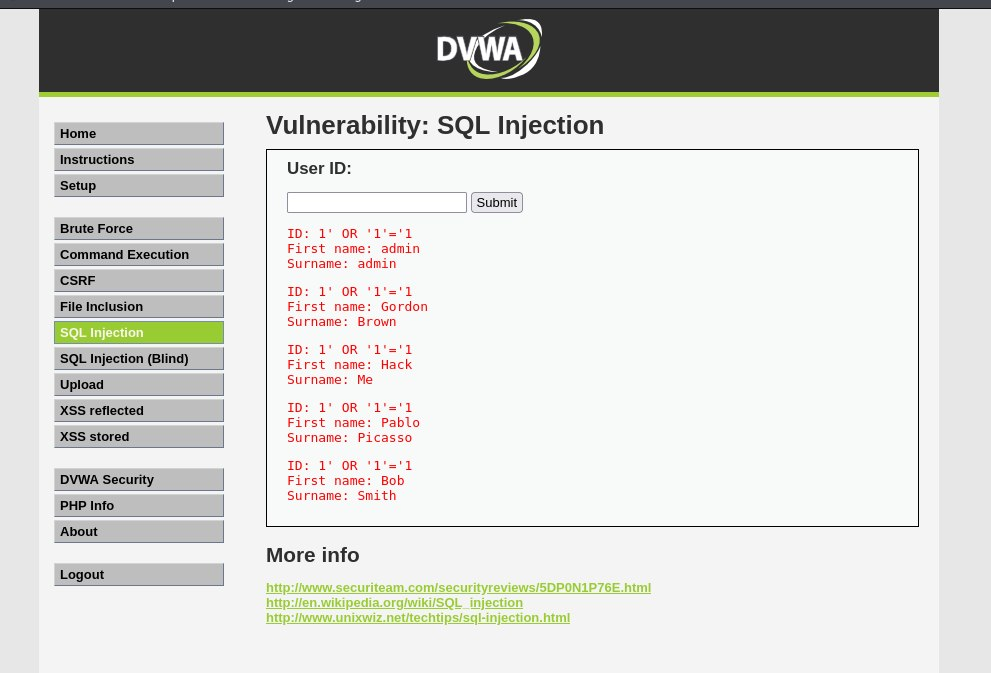
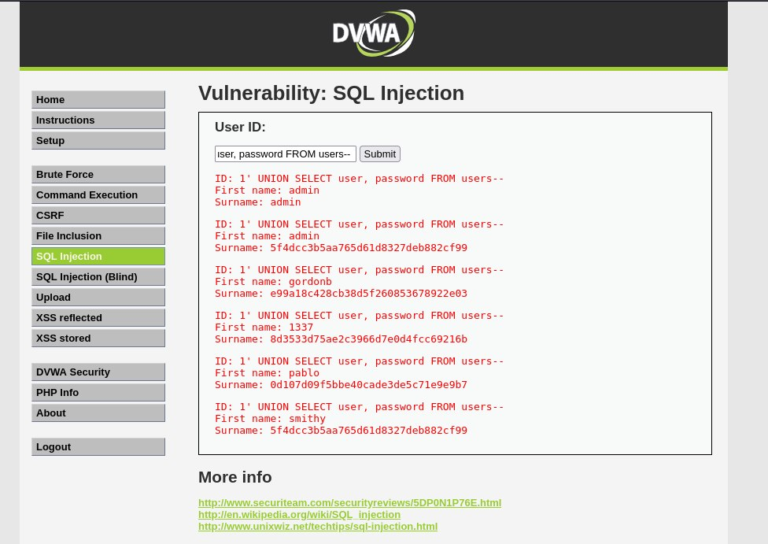
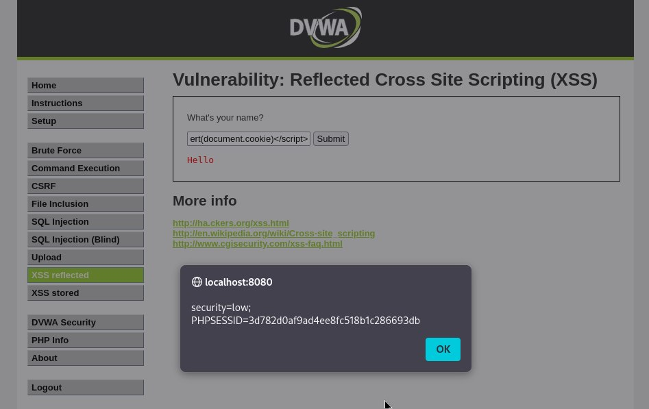

## 🎯 Цель
Разобраться, как работают SQL-инъекции и XSS, эксплуатируя DVWA (Damn Vulnerable Web Application) в изолированной лаборатории.

## 🛠️ Лабораторный стенд
- **QEMU** + Metasploitable 2
- **DVWA** (уровень безопасности: Low)
- **Kali Linux**
- **Проброс портов:** 8080 → 80

## 🔴 SQL-инъекция

### Тест 1: обычный запрос
**Ввод:** `1`
**Результат:** один пользователь (admin/admin)

### Тест 2: обход аутентификации
**Ввод:** `1' OR '1'='1`
**Результат:** возвращены все пользователи

**Почему это работает:**
- Запрос превращается в: `SELECT * FROM users WHERE id = '1' OR '1'='1'`
- `'1'='1'` всегда истинно → возвращаются все строки

### Тест 3: на основе UNION (извлечение паролей)
**Ввод:** `1' UNION SELECT user, password FROM users-- `
**Результат:** все имена пользователей и хеши паролей

**Почему это работает:**
- `UNION` объединяет два запроса
- `-- ` (с пробелом!) превращает остаток запроса в комментарий

## 🔴 XSS (отражённый)

### Тест 1: кража cookie
**Ввод:** ``
**Результат:** сессионный cookie раскрыт

**Почему это работает:**
- Сайт вставляет ввод в HTML без кодирования
- Браузер выполняет скрипт

## 🛡️ Защита (Blue Team)

### SQL-инъекция
- **Подготовленные выражения** (параметризованные запросы)
- **Валидация ввода** (только цифры для ID)
- **WAF** (ModSecurity)
- **Минимальные привилегии** (пользователь БД только с правом SELECT)

### XSS
- **Кодирование вывода** (`<` → `&lt;`)
- **Content Security Policy** (CSP)
- **Cookie с флагом HttpOnly** (JS не может их прочитать)
- **Cookie с атрибутом SameSite**

## 📚 Ключевые выводы
- Пользовательскому вводу **никогда** нельзя доверять
- DVWA демонстрирует уязвимости, встречающиеся в реальном мире
- **Purple Team:** атаковать, чтобы понять; защищать, чтобы обезопасить
- И SQLi, и XSS входят в **OWASP Top 10**

## 🔗 Связанные материалы
- [Обнаружение этих атак с помощью Wazuh SIEM](../SIEM/)
- [Обзор лабораторных работ по кибербезопасности](../)

---

