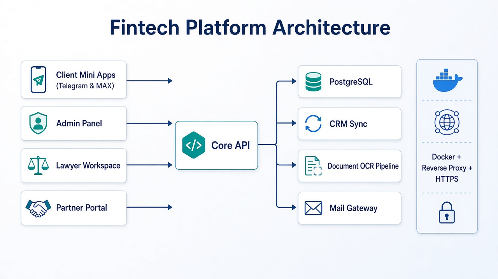

# 💻 Портфолио разработки

Full-stack-разработка **коммерческой платформы в сфере финтеха / кредитного консалтинга** (более 2,5 года): клиентские приложения, основной API (Core API), интеграции с CRM, инструменты для юристов, партнёрские комиссии и продакшен-инфраструктура на собственном сервере.

> **Конфиденциальность:** исходный код, секреты, env-файлы, вебхуки и данные клиентов **не** публикуются (NDA / безопасность продакшена).  
> В этой папке — только **кейсы**, обзор архитектуры и скриншоты **публичных экранов входа**.

## Проекты

| Проект | Статус | Стек (в общих чертах) | Ссылка |
|---------|--------|--------------------|------|
| [Основной API (Core API)](./core-api/) | Продакшен | C# · ASP.NET Core · PostgreSQL | [Открыть](./core-api/) |
| [Клиентское мини-приложение](./client-mini-app/) | Продакшен | React · TypeScript · Telegram/MAX | [Открыть](./client-mini-app/) |
| [Админ-панель](./admin-panel/) | Продакшен | React · TypeScript | [Открыть](./admin-panel/) |
| [Рабочее место юриста](./lawyer-workspace/) | Продакшен | FastAPI · Документы · CRM | [Открыть](./lawyer-workspace/) |
| [Партнёрская программа](./partner-program/) | Продакшен | Django · React · Вебхуки | [Открыть](./partner-program/) |
| [Автоматизация работы с БКИ](./bureau-automation/) | Продакшен (робот — опционально) | FastAPI · OCR · Почтовый агент | [Открыть](./bureau-automation/) |
| [Продакшен-инфраструктура](./production-infra/) | Продакшен | Docker · Traefik · Почта · DNS | [Открыть](./production-infra/) |
| [Credit Enot](./credit-enot/) | **В разработке** | React Native · ASP.NET · Python | [Открыть](./credit-enot/) |

## За что я отвечал

- Поставка продукта от начала до конца (не только фичи — ещё и деплой, инциденты, регламенты (runbooks))
- Продакшен из нескольких стеков на одном собственном сервере
- Безопасность воронок CRM (защитные проверки воронок, целостность комиссий)
- Мини-приложения для двух платформ (Telegram + MAX)

## Продемонстрированные навыки

`C#` · `ASP.NET Core` · `Python` · `FastAPI` · `Django` · `React` · `TypeScript` · `React Native` · `PostgreSQL` · `Docker` · `Traefik` · `Bitrix24` · `Telegram Mini Apps` · `OCR` · `JWT` · `Webhooks`

## Правила для скриншотов

Реальные снимки интерфейса: публичные экраны входа, документация OpenAPI, клиентские сценарии на демо- и тестовых данных (fixtures), а также панели статуса инфраструктуры.

**Намеренно исключены:** личные кабинеты клиентов после авторизации с реальными персональными данными (PII), PDF-файлы сделок, письма, `.env`, токены, URL вебхуков.
