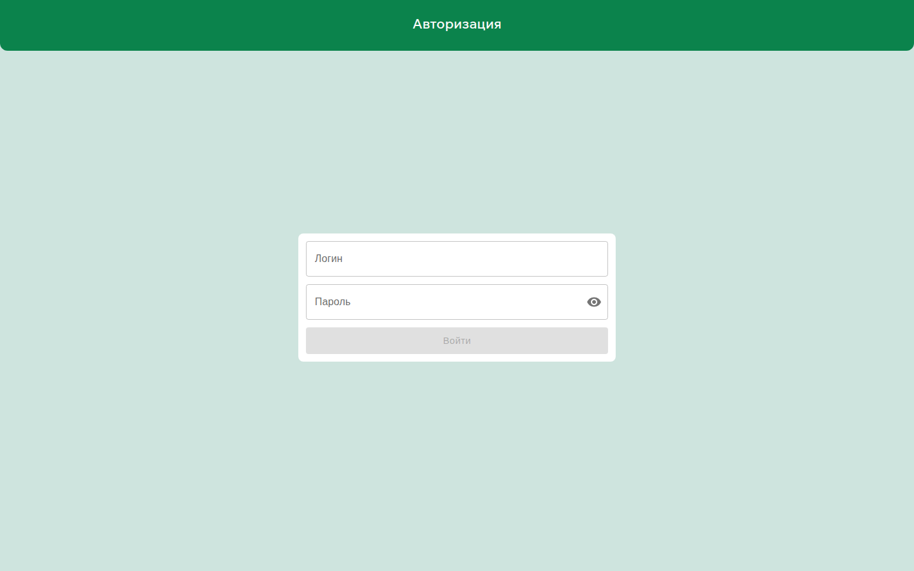

# Админ-панель (для операторов)

## Скриншоты

Только публичный экран аутентификации.

**Роль:** Фронтенд  
**Статус:** Продакшен  
**Стек:** React · TypeScript · Vite · MUI

## Обзор

Внутренний инструмент для операторов: авторизация, открытие сделок, исправление данных клиентов, управление статусами — работает через основной API (Core API).

## Что я сделал

- Интерфейс входа и редактирования сделок для повседневной поддержки
- Маршрутизация API для сборок под офисную локальную сеть (LAN) и под публичный HTTPS
- Рабочие сценарии операторов, сокращающие рутинные клики в CRM

## Результаты

- Операторы могут исправлять типичные проблемы со сделками из одной панели
- Тот же визуальный язык, что и у остальных React-приложений платформы

## Сложная проблема

**Неверный хост API при открытии админки по IP в локальной сети** — визуально вход проходил, но запросы падали.  
**Решение:** автоматическая маршрутизация LAN → локальный порт API; сборки для домена используют HTTPS API через env-переменные, задаваемые на этапе сборки (после изменения env нужна пересборка).

## Конфиденциальность

На скриншоте **только публичный интерфейс входа** (без записей клиентов).
