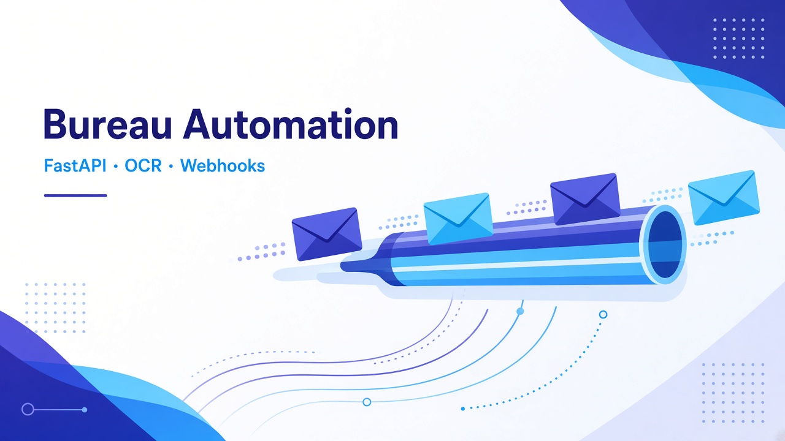
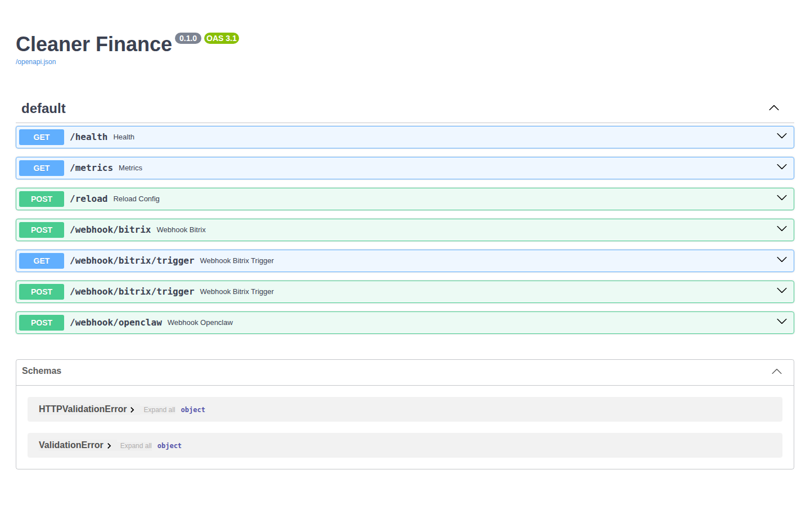
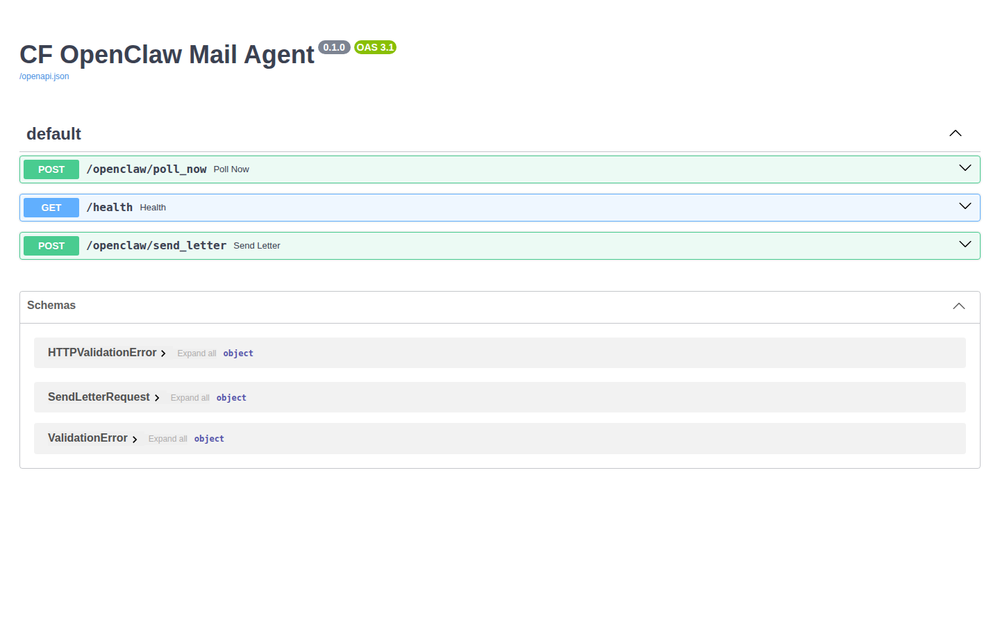

# Автоматизация работы с БКИ (CRM-робот)

## Скриншоты

Публичный OpenAPI робота для вебхуков и почтового агента. Без секретов вебхуков.

**Роль:** Бэкенд-автоматизация  
**Статус:** Продакшен (опционально — можно остановить, когда не используется)  
**Стек:** FastAPI · вебхуки CRM · OCR · заполнение DOCX · почтовый агент · HMAC-колбэки

## Обзор

Робот, работающий по вебхукам: при смене стадии в CRM он собирает файлы сделки, распознаёт поля паспорта через OCR, заполняет шаблоны претензий, загружает письма, поручает почтовому агенту отправку, а затем классифицирует ответы.

## Что я сделал

- Конвейер обработки с привязкой к стадиям (stage-gated) и блокировкой файлов для каждой сделки
- Классификация PDF (паспорт или отчёты бюро кредитных историй (БКИ))
- Заполнение документов с использованием готового изображения подписи (а не ненадёжного OCR подписи)
- Строгие проверки категорий CRM перед любым скачиванием или записью
- Маскирование персональных данных (PII) в логах

## Результаты

- Массовая типовая переписка без ручного копирования и вставки
- Чёткое разделение: робот — для большого потока, интерфейс юриста — для сложных случаев и повторных попыток

## Сложная проблема

**Вмешательство робота в чужие воронки CRM** (партнёрскую / рассрочки) привело бы к порче сделок.  
**Решение:** проверка по allowlist/blocklist **до** скачивания файлов; возможность остановить стек, чтобы экономить RAM, когда он не используется.

## Конфиденциальность

URL вебхуков, HMAC-секреты и образцы писем не публикуются.
