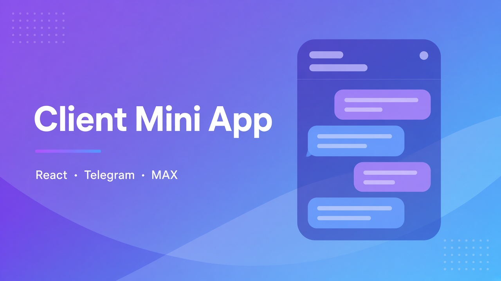
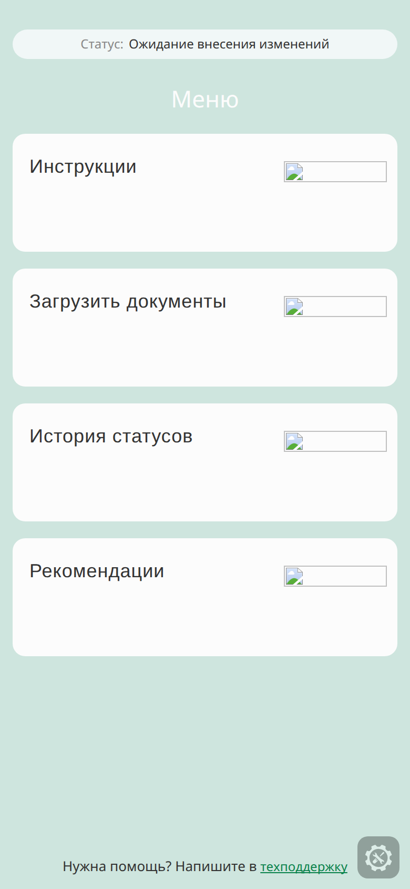

# Клиентское мини-приложение (Telegram + MAX)

## Скриншоты

Мобильное меню клиента с плашкой статуса сделки (демо/тестовые данные — без реальных персональных данных (PII) клиентов).

**Роль:** Фронтенд / поставка продукта  
**Статус:** Продакшен  
**Стек:** React · TypeScript · Vite · MUI · React Query · мосты Telegram и MAX WebApp

## Обзор

Личный кабинет клиента внутри мессенджеров: онбординг без отдельного релиза нативного приложения в магазинах приложений.

## Что я сделал

- Полный путь клиента: регистрация → сертификат → электронная подпись → загрузка отчёта из бюро кредитных историй (БКИ) → статус сделки
- Единая кодовая база для **Telegram Mini App** и **MAX Mini App**
- Слой адаптеров / мостов для платформ: параметры запуска и идентификация пользователя
- Деплой в продакшен через Docker-образы (с маркерами версии при запуске — boot markers)

## Результаты

- Самостоятельный онбординг для конечных клиентов
- Поставка на две платформы без поддержки двух отдельных продуктов

## Сложная проблема

**Webview MAX ломался при подключении Telegram SDK** — бесконечные загрузчики / «failed to get profile».  
**Решение:** отдельный мост для каждой платформы, Telegram-скрипты в MAX не загружаются никогда, маркеры запуска (boot markers) и обязательная пересборка образов (хотфиксы через `docker cp` пропадали после пересоздания контейнера).

## Конфиденциальность

Без исходного кода и секретов. Интерфейс личных кабинетов клиентов после авторизации не показан (риск раскрытия персональных данных — PII).
