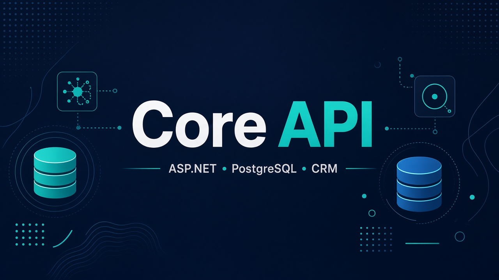
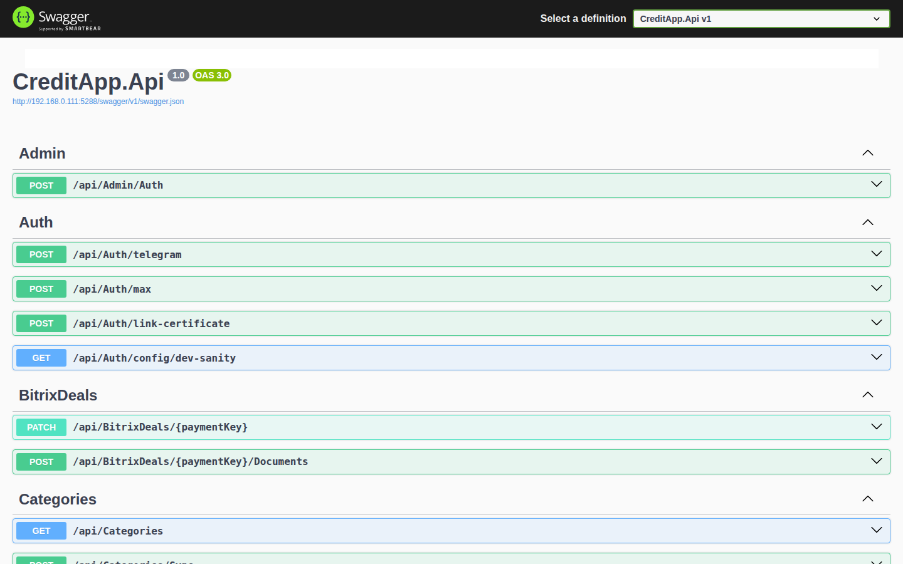
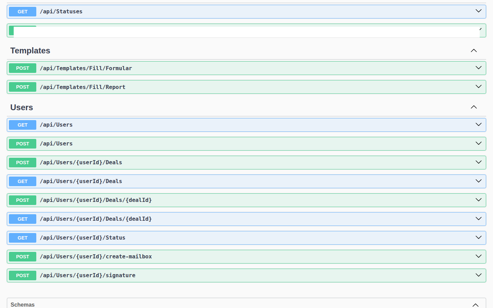

# Основной API (Core API)

## Скриншоты

Публичная документация OpenAPI (адрес в локальной сети скрыт). Секреты и содержимое запросов не показаны.

**Роль:** Бэкенд / платформа  
**Статус:** Продакшен  
**Стек:** C# · ASP.NET Core · EF Core · PostgreSQL · Hangfire · CRM REST · Mail API · вспомогательные модули OCR/LLM

## Обзор

Центральный REST API финтех-платформы. Обслуживает клиентское мини-приложение, админ-панель операторов, ботов и сценарии анализа для юристов.

## Что я сделал

- Жизненный цикл пользователя и сделки (регистрация, документы, электронная подпись, статусы)
- Фоновые задачи (Hangfire) для синхронизации с CRM и уведомлений
- Парсинг отчётов бюро кредитных историй (БКИ: NBKI / OKB / SB) и процессы, связанные с PDF
- Интеграция с ботами Telegram / MAX
- Создание рабочих почтовых ящиков для клиентов через API почты, развёрнутой на собственном сервере
- Проверки категорий, чтобы запись в CRM шла только в разрешённые воронки

## Результаты

- Единый источник истины по клиентам, сделкам и интеграциям
- Стабильный публичный HTTPS API за обратным прокси (reverse proxy)
- Общий бэкенд для нескольких фронтендов без дублирования бизнес-логики

## Сложная проблема

**Ненадёжный парсинг отчётов БКИ и побочные эффекты в CRM** — неверное сопоставление полей (например, путаница SMP и просрочки) и случайная запись в партнёрскую воронку / воронку рассрочки.  
**Решение:** итеративная доработка парсеров с циклами отладочных пересборок + жёсткие allow/block-списки для категорий CRM.

## Конфиденциальность

Исходный код, строки подключения, токены и внутренние ID полей здесь не публикуются.
