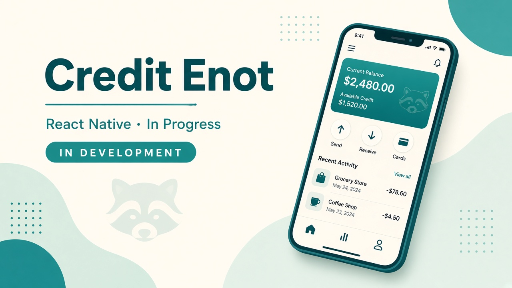
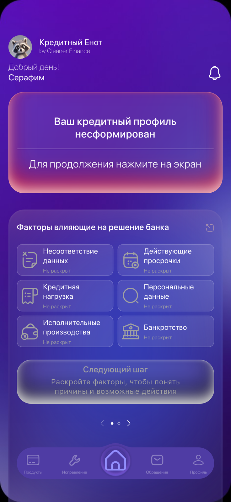

# Credit Enot — B2C-приложение *(в разработке)*

## Скриншоты

Мобильный интерфейс в разработке (демо-режим, вымышленное имя пользователя).

**Роль:** Продукт / архитектура / мобильная разработка  
**Статус:** 🚧 **В активной разработке**  
**Стек:** React Native (Expo) · ASP.NET Core API · Python-сервисы претензий и почты

## Обзор

Новая изолированная продуктовая линейка **B2C** («Credit Enot»). Намеренно **не** подключена к legacy-стеку мини-приложения / партнёрской программы / CRM (за исключением общей почтовой инфраструктуры, где это необходимо).

## Что уже готово

- Каркас мобильного приложения: OTP-авторизация (заглушка/демо), цели при онбординге, загрузка отчёта из бюро кредитных историй (БКИ), вопросы о доходе
- Главный экран: карусель → рейтинг/профиль после шагов онбординга
- Кастомный таб-бар и интерфейс промо-предложения с ограниченным сроком действия (локальный таймер для каждого пользователя)
- Состояния бейджа уведомления об отчётах (отчёты устарели / ответ от БКИ / нет) — правила на бэкенде в работе
- Отдельный compose для деплоя API, сервиса претензий и почтового агента
- Документация по продуктовым решениям и схемам переходов между экранами

## Над чем я работаю дальше

- Промо/предложения и типы уведомлений на стороне сервера
- Усиление авторизации, выходящее за рамки демо-OTP
- Сборки для магазинов приложений (EAS), когда продукт будет готов

## Ограничения дизайна, выявленные на раннем этапе

- Не подменять SVG таб-бара целиком при смене состояния (иконка «Главная» «прыгает») — анимировать только свечение
- В вебе предпочитать PNG-свечение SVG-фильтрам, которые там работают некорректно
- Держать этот стек вне радиуса поражения legacy-продакшена

## Конфиденциальность

Без приватных ключей, учётных данных магазинов приложений и данных клиентов из продакшена. Этот кейс описывает только объём работ и архитектуру.
