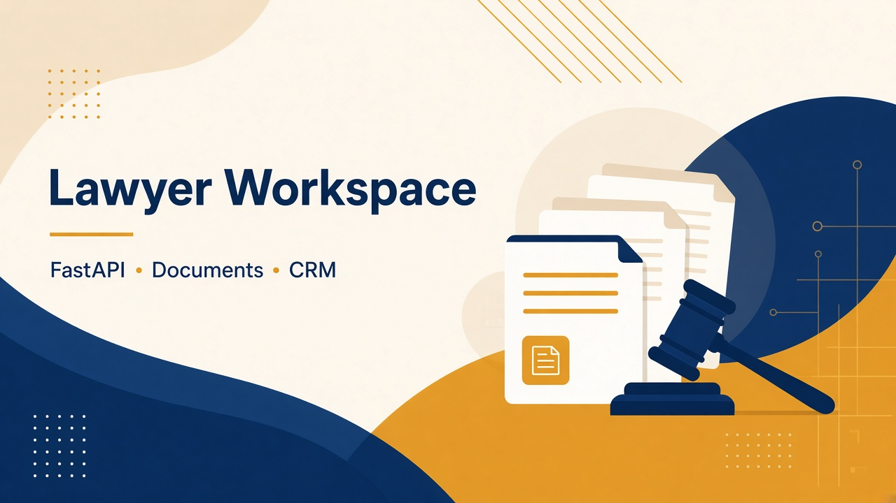
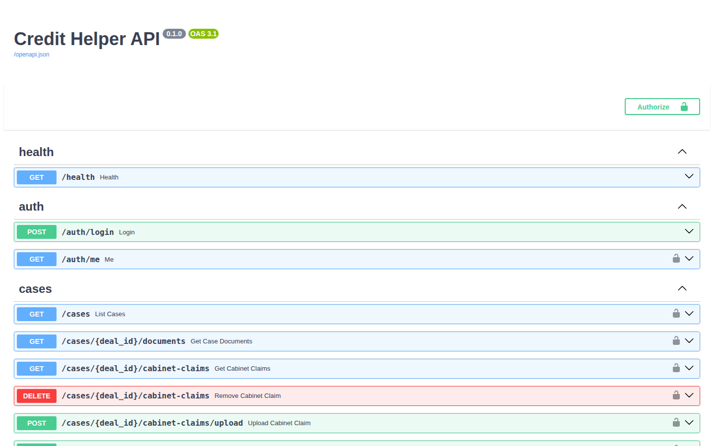

# Рабочее место юриста + почтовый агент

## Скриншоты

Интерфейс входа + публичная часть OpenAPI (без данных по делам).

**Роль:** Full-stack  
**Статус:** Продакшен  
**Стек:** FastAPI · веб-интерфейс · синхронизация с CRM · OCR · генерация DOCX · почтовый агент · LLM-помощники для OCR

## Обзор

Рабочее место для юристов: синхронизация сделок из CRM, анализ кредитных отчётов, построение матрицы оспаривания, генерация претензионных писем, отправка и получение писем бюро кредитных историй (БКИ) под контролем человека.

## Что я сделал

- Конвейер: **Синхронизация → Отчёт → Матрица → Претензии → Отправка**
- Синхронизация сделок из Bitrix с проверкой комплектности документов
- Генерация претензий (DOCX) и опциональная обратная запись в CRM
- Почтовый агент в стиле OpenClaw, размещённый вместе со стеком юриста (контролируемая отправка)

## Результаты

- Юристы могут вести сложные дела, не полагаясь только на «слепого» робота
- Единая зона ответственности для агента и рабочих файлов сделок (меньше конфликтов портов и секретов)

## Сложная проблема

**Разделённое владение почтовым агентом между стеком автоматизации и стеком юриста** приводило к конфликтам портов и расхождению секретов.  
**Решение:** агент и рабочее пространство перенесены в стек юриста; робот Bitrix оставлен опциональным — для массовой автоматизации.

## Конфиденциальность

Только скриншот экрана входа. PDF сделок, паспорта и письма не публикуются.
