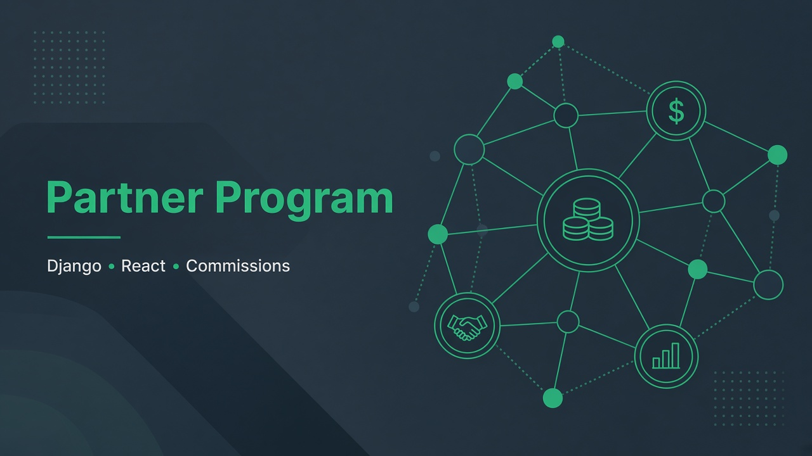
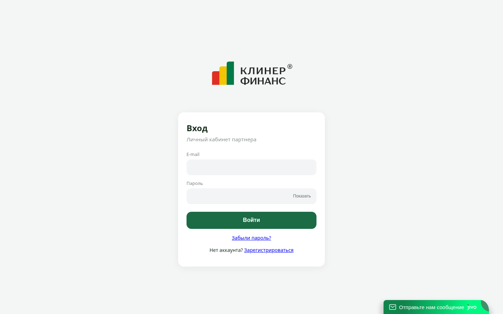
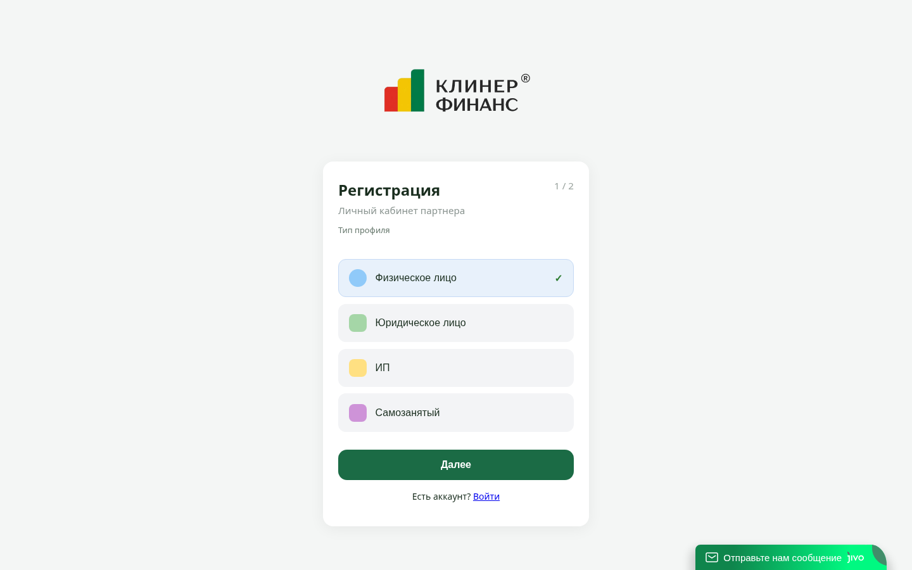

# Партнёрская программа (PRM)

## Скриншоты

Публичная авторизация партнёров и шаг 1 онбординга (тип профиля).

**Роль:** Full-stack  
**Статус:** Продакшен  
**Стек:** Django · DRF · JWT · React · TypeScript · PostgreSQL · вебхуки CRM

## Обзор

Регистрация партнёров, личный кабинет партнёра, офферы в админке и начисление комиссий по событиям сделок в CRM.

## Что я сделал

- Порталы для партнёров и администраторов (база данных отдельно от API основного продукта)
- Исходящие вебхуки CRM на создание/обновление сделки → правила начисления комиссий
- Синхронизация карточек партнёров в выделенной воронке CRM
- Поля атрибуции с резервными вариантами (fallback) на случай, когда платёжные формы пишут в разные пользовательские поля CRM

## Результаты

- Работающий партнёрский портал с прозрачной логикой вознаграждений
- Комиссии могут начисляться на настроенных стадиях — не только при «успешном» закрытии сделки

## Сложная проблема (самая критичная)

**Дублирование выплат партнёрам по сделкам в рассрочку.**  
После оплаты сделки возвращались из воронки сервиса рассрочки в основную воронку и повторно запускали начисления через вебхуки.  
**Решение:** жёсткие правила — **никаких начислений** в категории сервиса рассрочки; **никаких повторных начислений** при возврате в основную воронку; резервные UF-поля, чтобы не терялась атрибуция из Tilda и платёжных форм.

## Конфиденциальность

Только скриншот экрана входа. Без балансов партнёров, ставок и ID сделок.
