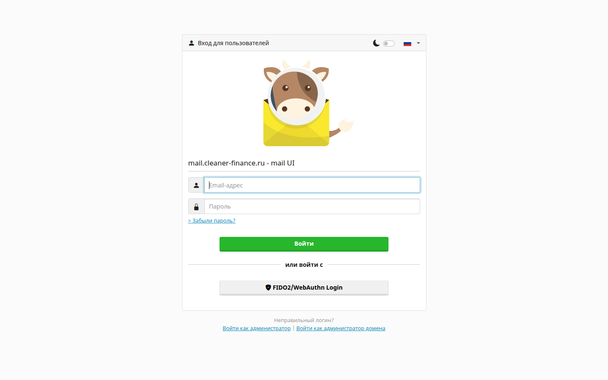
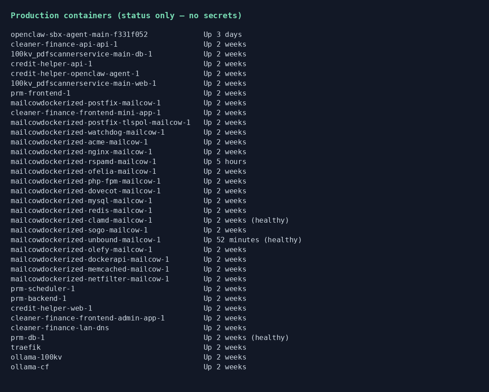

# Продакшен-инфраструктура

## Скриншоты

Интерфейс почты на собственном сервере + статус контейнеров в продакшене (только имена и статусы).

**Роль:** DevOps / платформа  
**Статус:** Продакшен  
**Стек:** Docker Compose · Traefik (HTTPS) · почта на собственном сервере · split DNS · скрипты резервного копирования

## Обзор

Продакшен всех сервисов платформы на одном собственном сервере: обратный прокси, TLS, базы данных, почта, офисный DNS, подъём после перезагрузки, резервные копии.

## Что я сделал

- Оркестрация нескольких compose-стеков с правильным порядком запуска
- Терминация HTTPS и маршрутизация по имени хоста
- Почта на собственном сервере для SMTP приложений и рабочих почтовых ящиков клиентов
- Скрипт резервного копирования баз данных всех продуктов + БД почты
- Политика удаления неактивных почтовых ящиков
- Офисный split DNS, чтобы домены резолвились в IP локальной сети, не ломая маркетинговый DNS
- Регламенты (runbooks), удобные для удалённой работы (документация в стиле `AGENTS` / `COMMANDS`)

## Результаты

- Все публичные продукты работают по HTTPS, у каждого есть URL для проверки работоспособности (health check)
- Процедура восстановления после перезагрузки
- Задокументированные сценарии действий при инцидентах (почта, деплой мини-приложений, квоты)

## Сложные проблемы

| Проблема | Решение |
|-------|-----|
| Postfix на хосте занимал `:25` после перезагрузки → контейнер почты не работал | Замаскировать Postfix на хосте; пересоздать Postfix в контейнере почты; чек-лист |
| Исчерпана квота домена на почтовые ящики → регистрация проходила без создания почтового ящика | Повысить квоту домена; уменьшить размер ящика по умолчанию; удалять неактивные ящики |
| Gmail `550 NotAuthorized` при «зелёных» SPF/DKIM | Диагностирована проблема с **репутацией IP** → отправка через relay/smart-host, а не «подкрутить DNS и надеяться» |
| Случайные правки DNS на хосте могут оставить офис без интернета | Правило «только диагностика», если изменения не согласованы явно |

## Конфиденциальность

IP-адреса серверов здесь не нужны; нет `.env`, приватных материалов ACME и API-ключей.
